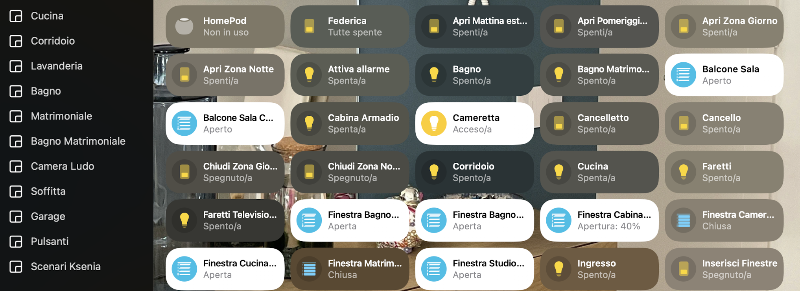
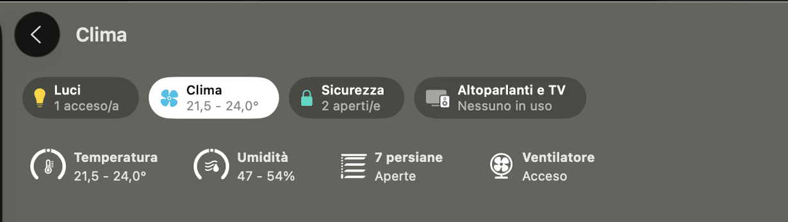

# homebridge-plugin-klares4

**Bring your Ksenia Lares4 alarm system into Apple HomeKit, Matter and MQTT** — security zones, lights, covers, gates, thermostats, scenarios and environmental sensors, from a single Homebridge plugin. Local-only over WebSocket, no cloud, no telemetry. With Homebridge 2.x the same accessories are also exposed over **Matter** to Alexa, Google Home and SmartThings.

[](https://www.npmjs.com/package/homebridge-plugin-klares4)
[](https://www.npmjs.com/package/homebridge-plugin-klares4)
[](https://github.com/homebridge/homebridge/wiki/Verified-Plugins)
[](https://nodejs.org)
[](https://opensource.org/licenses/MIT)
[](https://github.com/paolo-trivi/homebridge-plugin-klares4/stargazers)



*Zones, lights, covers, thermostats and Ksenia scenarios appear as native HomeKit accessories, grouped by room.*



*Environmental sensors and climate controls integrate into the Home app's category views (Climate, Security, Lights).*

**[English](#english) · [Italiano](#italiano)** — the two halves of this file say the same thing, section by section. Detailed pages: [`docs/`](docs/README.md).

---

## English

### Why this plugin?

| | **homebridge-plugin-klares4** | Home Assistant + HomeKit Bridge | Ksenia ergo / Lares 4.0 app | None (no HomeKit) |
|---|---|---|---|---|
| Native HomeKit (Siri, scenes, automations) | ✅ | ✅ (via HA bridge) | ❌ | ❌ |
| **Matter** (Alexa, Google Home, SmartThings) | ✅ via Homebridge 2.x | ✅ via HA Matter Server | ❌ | ❌ |
| Works **fully local** (no cloud) | ✅ | ✅ | depends | n/a |
| Setup effort | Install + IP/PIN | Full HA stack required | Already installed | n/a |
| Zones, lights, covers, thermostats, env. sensors | ✅ all in one | ✅ (community/HACS, if any) | ✅ (Ksenia UI only) | n/a |
| Thermostats exposed as native Matter Thermostats | ✅ | partial | n/a | n/a |
| MQTT bridge built-in | ✅ optional | via HA | ❌ | n/a |
| Real-time updates (WebSocket) | ✅ | ✅ | ✅ | n/a |
| `.ksa` backup import for routing & room mapping | ✅ | ❌ | n/a | n/a |
| No telemetry, no third-party connection | ✅ | depends | n/a | n/a |
| Open source | ✅ MIT | ✅ | ❌ | n/a |

If you already run Home Assistant, both options are valid; this plugin is the simplest path if your hub is already Homebridge.

### Features

- **Security zones** as contact sensors, with bypass and tamper status.
- **Lights** (on/off, and brightness for dimmers), **covers** (position), **gates** (momentary), **scenarios** (momentary switches) and **thermostats** (Off/Heat/Cool/Auto).
- **Environmental sensors**: temperature, humidity and light from the DOMUS bus, plus the panel's own internal and external temperatures.
- **Fail-closed exposure**: only what the plugin recognizes is exposed; sirens, irrigation, indicators and unknown scenarios stay hidden until you opt them in one by one. See [Exposure policy](#exposure-policy-fail-closed).
- **Verified command outcomes**: a command counts as done only when the panel acknowledges it or its realtime state confirms it; refusals and timeouts reach HomeKit, Matter and MQTT as errors.
- **Matter** through Homebridge 2.x, with native Thermostats, automatic recovery and stable identities.
- **Optional MQTT bridge** with state topics, command topics and an availability (`status`) topic.
- **Settings UI** in Homebridge, custom names, per-device exclusions, room mapping and `.ksa` backup import.
- **Private by design**: the plugin talks only to your panel (and to your MQTT broker if you turn it on). The debug file is confidential.

### Requirements and compatibility

- A Ksenia **Lares 4.0** panel (firmware exposing the `KS_WSOCK` WebSocket subprotocol on the local IP) and a user PIN enabled for the WebSocket API. If your model works or has issues, please open an issue so the list can grow.
- **Node.js 22.12 or later.** Node 22, 24 and 26 are tested in CI. Matter needs Node 22.13 or later: the Matter stack of Homebridge 2.5 (matter.js 0.18) does not install on 22.12.
- **Homebridge**: the package accepts `^1.6.0 || ^2.0.0-beta.0`. Homebridge **2.5.x** is the verified version (contract tests against the real Homebridge Matter stack, and a real installation); **2.4.x** is covered by a CI contract job; **1.x is not tested** and may work for HomeKit only. **Matter requires Homebridge 2.x.**
- **HomeKit limit**: one Homebridge bridge accepts at most **149 accessories**. Beyond that the plugin logs one warning (`HomeKit (HAP) limit reached`) and the other devices stay available on Matter and MQTT. Use the exclusion lists or a child bridge to stay under the limit.
- **One panel per Homebridge instance**: device IDs (`light_1`, `zone_3`) are not namespaced per panel, so two `Lares4Complete` blocks in the same Homebridge instance would collide on accessory identities, on the plugin's files in the storage folder and on MQTT topics. For a second panel run a second Homebridge instance with its own storage folder and a different `mqtt.topicPrefix`.

### Installation

#### Via Homebridge UI (recommended)

1. Open Homebridge UI.
2. Go to **Plugins** and search for `homebridge-plugin-klares4`.
3. Click **Install**.
4. Configure the plugin in the settings form.

#### Via npm

```bash
npm install -g homebridge-plugin-klares4
```

### Updating the plugin (important)

**Always update in place** (Homebridge UI → Plugins → Update, or `npm update -g homebridge-plugin-klares4`).

**Never uninstall and reinstall the plugin, and never delete or regenerate the Matter child bridge**, to "fix" an issue: that regenerates the bridge username and the Matter storage and destroys the commissioned fabrics. Every controller (Apple Home, Alexa, Google) then sees a brand-new bridge and you must pair it again and rebuild rooms and automations from scratch.

In-place updates are safe by design: accessory UUIDs, serial numbers and Matter identities are stable across versions.

**Upgrading from 2.2.x?** Read [Upgrading from 2.2.x](CHANGELOG.md#upgrading-from-22x-read-first) first: outputs of an unrecognized category and some scenarios are now hidden until you opt them in, thermostats become native Matter Thermostats (a new accessory for your controllers), and the `telemetry` setting is gone.

### Configuration

Only `ip` and `pin` are required. Everything else has a default.

> **The PIN is stored in clear text in Homebridge's `config.json`.** Use a dedicated panel user with only the rights this plugin needs, and protect the Homebridge storage folder.

Example `config.json` platform block (the settings form writes the same keys):

```json
{
	"platforms": [
		{
			"platform": "Lares4Complete",
			"name": "Klares4",
			"ip": "192.168.1.100",
			"pin": "123456",
			"excludeZones": ["1", "5"],
			"excludeOutputs": ["2", "7"],
			"exposeOutputs": [{ "outputId": "12", "exposeAs": "light" }],
			"exposeScenarios": [{ "scenarioId": "4" }],
			"customNames": [
				{ "deviceId": "zone_1", "name": "Front Door" },
				{ "deviceId": "light_9", "name": "Living Room Light" },
				{ "deviceId": "cover_1", "name": "Office Blind" }
			]
		}
	]
}
```

How values are read:

- Each on/off option must be a real `true` or `false`. A value of another type (`"true"`, `1`, `"false"`) is ignored, the safe default applies and one warning at startup names the key.
- Numbers outside the limits below are moved to the nearest limit; a value that is not a number falls back to the default. A warning at startup lists each correction. These limits are enforced by the plugin, not only by the settings form.
- Lists must be lists. An entry that is not valid for its list is dropped and named in the warning.
- The startup log prints every discovered device with its **ID** (for `customNames`, `matterOverrides`, `roomMapping`) and its **exclude** value (for the `exclude*` lists).

#### Configuration parameters

| Key | Type | Default | Limits | Description |
|---|---|---|---|---|
| `name` | string | "Klares4" | — | Platform name shown in the Homebridge log |
| `ip` | string | required | — | IP address of the Lares4 panel |
| `port` | integer | 443 / 80 | 1..65535 | WebSocket port. Leave it empty: 443 with `https`, 80 without. Set it only if the panel uses another port; an explicit `port: 443` with `https: false` does not connect |
| `https` | boolean | true | — | Encrypted WebSocket (`wss://`) |
| `allowInsecureTls` | boolean | false | — | Turns off the check of the panel's TLS certificate and allows the legacy TLS renegotiation most panels need. Trusted LAN only; only when the log asks for it. Only the JSON value `true` turns it on |
| `sender` | string | "homebridge" | — | Name that identifies this connection on the panel (letters, digits, `-`, `_`) |
| `pin` | string | required | — | User PIN allowed to use the WebSocket API (4-8 digits). Stored in clear text in `config.json` |
| `showAdvanced` | boolean | false | — | Settings form only: unlocks the advanced parameters; the plugin ignores it |
| `debug` | boolean | false | — | Legacy switch, the same as `logLevel: 2`: when it is on, the level is 2 whatever `logLevel` says |
| `logLevel` | integer | 1 | 0, 1, 2 | `0` writes warnings and errors only; `1` (default) adds connection and synchronization, the startup device summary, commands, accessories added and removed; `2` adds everything else (each state change reported by the panel, per-device discovery lines, masked frames), written at info level and marked `[debug]`, so Homebridge does not have to run in debug mode (`-D`) |
| `maxSeconds` | integer | 30 | 5..300 | Seconds a cover needs to open or close completely. HomeKit (HAP) only |
| `reconnectInterval` | integer | 5000 | 1000..60000 | Milliseconds before the first reconnection attempt; doubles at every failed attempt and restarts after a complete synchronization |
| `heartbeatInterval` | integer | 30000 | 10000..300000 | Milliseconds between the keep-alive pings that detect a dead connection |
| `commandTimeoutMs` | integer | 8000 | 1000..30000 | Maximum wait for the panel's answer to a command, thermostats included. A command still queued after this time is refused instead of being sent late |
| `coverStepSize` | integer | 5 | 1..20 | Percentage moved at each animation step while a cover travels in HomeKit. HomeKit (HAP) only |
| `scenarioAutoOffDelay` | integer | 500 | 100..5000 | Milliseconds before a scenario switch, or a gate, returns to Off after it was triggered |
| `exposePartialArmScenarios` | boolean | false | — | Exposes partial-arm scenarios (category `PARTIAL`). Off by default: they are neither exposed nor runnable, like ARM/DISARM scenarios, which are never exposed. Turn it on only if you accept that anyone who can operate the switch (voice assistants, scenes, automations, MQTT) can partially arm the alarm without a PIN prompt |
| `exposeOutputs` | array | [] | — | Outputs of an unrecognized category to expose anyway: `[{ outputId, exposeAs }]`, `outputId` the numeric output ID, `exposeAs` only `"light"` (what an empty value means). See [Exposure policy](#exposure-policy-fail-closed) |
| `exposeScenarios` | array | [] | — | Scenarios of an unknown category to expose anyway: `[{ scenarioId }]`. Never exposes ARM/DISARM; PARTIAL follows `exposePartialArmScenarios` only |
| `devicesSummaryDelay` | integer | 2000 | 500..10000 | Milliseconds to wait before the device summary is printed in the log |
| `excludeZones` | array | [] | — | Zones to leave out, by numeric ID (`"5"` for `zone_5`; `5` and `"zone_5"` also work) |
| `excludeOutputs` | array | [] | — | Outputs to leave out: lights, covers, gates, thermostats (`"37"` for `light_37`) |
| `excludeSensors` | array | [] | — | Sensors to leave out: a numeric DOMUS ID hides all three readings; `sensor_system_temp_in` / `sensor_system_temp_out` for the panel's own temperatures |
| `excludeScenarios` | array | [] | — | Scenarios to leave out, by numeric ID |
| `matterExposure.zones` | boolean | true | — | Matter only: expose zones (contact sensors) |
| `matterExposure.sensors` | boolean | true | — | Matter only: expose environmental sensors |
| `matterExposure.scenarios` | boolean | true | — | Matter only: expose scenarios |
| `matterExposure.lights` | boolean | true | — | Matter only: expose lights |
| `matterExposure.covers` | boolean | true | — | Matter only: expose covers |
| `matterExposure.gates` | boolean | true | — | Matter only: expose gates |
| `matterExposure.thermostats` | boolean | true | — | Matter only: expose thermostats |
| `matterOverrides` | array | [] | — | Per-device Matter-only overrides: `[{ deviceId, name, exposed }]`. HomeKit and MQTT are not affected. A row with `exposed: true` keeps the device exposed even if its type is off in `matterExposure` |
| `matterRecoveryRequests` | array | [] | — | One-shot requests for another native-Thermostat attempt: `[{ deviceId, generation }]`, `deviceId` a `thermostat_*` ID, `generation` an integer of at least 1 that only ever increases |
| `matterUnregisterTimeoutMs` | integer | 3000 | 500..30000 | Milliseconds to wait for a removed Matter endpoint to really disappear before giving up and keeping the current name |
| `customNames` | array | [] | — | Names shared by HomeKit, MQTT and Matter: `[{ deviceId, name }]`. `sensor_<id>` names all three readings of a DOMUS sensor; `sensor_system_temp_in` / `_out` rename the panel's own temperatures (name used as written). The old per-category map is still read, but the Homebridge UI deletes it on the next save |
| `temperatureDefaults.target` | number | 21 | 5..35 | Setpoint (°C) shown while a thermostat has not reported one. HomeKit (HAP) thermostat; Matter uses its own defaults |
| `temperatureDefaults.min` | number | 10 | 5..20 | Lowest setpoint (°C) of the HomeKit (HAP) thermostat; also refuses lower MQTT setpoints. Matter uses fixed ranges (heating 5-30 °C, cooling 16-35 °C) |
| `temperatureDefaults.max` | number | 38 | 25..40 | Highest setpoint (°C) of the HomeKit (HAP) thermostat; also refuses higher MQTT setpoints |
| `temperatureDefaults.step` | number | 0.5 | 0.5, 1 | Setpoint step (°C) of the HomeKit (HAP) thermostat |
| `domusThermostat.enabled` | boolean | true | — | Use the DOMUS sensors for the current temperature of thermostats |
| `domusThermostat.sensorFreshnessMs` | integer | 300000 | 30000..3600000 | How long a realtime thermostat reading takes precedence over the DOMUS sensor reading |
| `domusThermostat.manualPairs` | array | [] | — | Links a thermostat output to a DOMUS sensor: `[{ thermostatOutputId, domusSensorId }]` |
| `domusThermostat.manualCommandPairs` | array | [] | — | Links a thermostat output to the panel thermostat ID used for commands: `[{ thermostatOutputId, commandThermostatId }]`. Written by the KSA import; a pair that points to an ID the panel does not have makes every write fail |
| `ksaImport.enabled` | boolean | false | — | Load the `.ksa` backup at startup to derive thermostat mappings and room data |
| `ksaImport.filePath` | string | — | — | Absolute path of the `.ksa` backup exported from the panel |
| `ksaImport.applyAtStartup` | boolean | false | — | Write the selected sections into `config.json` at the next start, then switch itself off |
| `ksaImport.applyDomusMappings` | boolean | true | — | Add the thermostat mappings of the backup that are missing; the pairs you configured are never replaced |
| `ksaImport.applyRoomMapping` | boolean | true | — | Use the panel's room names for MQTT topics when you defined no rooms; never turns `roomMapping` on |
| `ksaImport.applyCustomNames` | boolean | false | — | Add the panel's names for devices you have not named yourself |
| `mqtt.enabled` | boolean | false | — | Turn the MQTT bridge on |
| `mqtt.commands` | boolean | true | — | Accept commands over MQTT. Off: state and availability only, no `.../set` subscription. A value that is neither `true` nor `false` also turns commands off. See [MQTT security](#mqtt-security) |
| `mqtt.broker` | string | — | — | Broker URL with its scheme (`mqtt://host:1883`, `mqtts://host:8883`) |
| `mqtt.port` | integer | — | 1..65535 | Overrides the port in the broker URL. Empty: the URL's port, or the protocol default (1883 for `mqtt://`, 8883 for `mqtts://`) |
| `mqtt.username` | string | — | — | Broker user (optional) |
| `mqtt.password` | string | — | — | Broker password (optional) |
| `mqtt.clientId` | string | — | — | Must be unique for each Homebridge instance on the same broker; empty for a random one |
| `mqtt.topicPrefix` | string | "homebridge/klares4" | — | Prefix of every topic; cannot contain `+` or `#` |
| `mqtt.qos` | integer | 1 | 0, 1, 2 | Delivery guarantee |
| `mqtt.retain` | boolean | true | — | Retain state messages (the `status` topic is always retained) |
| `roomMapping.enabled` | boolean | false | — | Organize MQTT topics by room instead of by device type |
| `roomMapping.rooms` | array | [] | — | `[{ roomName, devices: [{ deviceId }] }]`; `roomName` lowercase letters, digits, `_` |
| `generateDebugFile` | boolean | false | — | Write a confidential diagnostic file at the next start, then switch itself off. See [Privacy and the debug file](#privacy-and-the-debug-file) |
| `debugCaptureDurationMs` | integer | 60000 | 10000..1800000 | Length of that capture. Raise it to 300000-600000 on Matter-only setups where Apple Home needs minutes to respond after a restart |

The legacy `telemetry` key is gone: if it is still in your `config.json` the plugin logs one line and ignores it. `ksaImport.applyExclusionSuggestions` is also ignored.

### Exposure policy (fail-closed)

The plugin exposes a device only if it knows what the device is. Anything else stays hidden and cannot be controlled, so a siren or a door strike never becomes a light that "turn off all the lights", a scene or an automation can switch with the stored PIN.

| Panel item | Exposed as |
|---|---|
| Zone | Contact sensor |
| Output `LIGHT` | Light (dimmer when the panel says so) |
| Output `ROLL` | Cover |
| Output `GATE` with mode `M` | Gate (momentary). Other `GATE` modes: cover |
| Thermostat output | Thermostat |
| DOMUS and panel temperature sensors | Temperature, humidity, light sensors |
| Scenario `GEN` | Momentary switch |
| Scenario `PARTIAL` | Only with `exposePartialArmScenarios` |
| Scenario `ARM` / `DISARM` | **Never** |
| Output `GEN` (sirens, alarm bridges, indicators, door strikes), `IRR` (irrigation), or without a category | **Hidden** unless listed in `exposeOutputs` |
| Scenario with no category or an unknown one | **Hidden** unless listed in `exposeScenarios` |

**Re-expose an output or a scenario.** At the first start the log lists everything that was hidden, with the exact lines to copy. For example:

```
Exposure policy: 2 device(s) of a category the plugin does not recognize are not exposed (HomeKit, Matter, MQTT) and cannot be controlled:
  - output 12 "Garden Siren" (category GEN, mode AT)
  - scenario 4 "Night Routine" (category none)
Expose only what is safe to switch from voice assistants, scenes and automations: to expose one, add its entry to the platform config (plugin settings or config.json):
  "exposeOutputs": [{"outputId":"12","exposeAs":"light"}]
  "exposeScenarios": [{"scenarioId":"4"}]
```

Add only the entries that are safe to operate from voice assistants, scenes and automations, in the plugin settings (**Device Selection → Expose Hidden Devices**) or in the platform block of `config.json`:

```json
"exposeOutputs": [
	{ "outputId": "12", "exposeAs": "light" }
],
"exposeScenarios": [
	{ "scenarioId": "4" }
]
```

Then restart Homebridge. An opted-in output comes back with the same ID (`light_<id>`), the same HomeKit identity and the same MQTT topic it had in 2.2.0, as a **light** (the only type available). A row that changes nothing (the output is already recognized, or the panel does not list it) is named in the startup warning. The panel's per-scenario PIN flag is read and reported: an exposed scenario flagged with a PIN requirement is listed in the log so you can check that running it without a code is intended.

When something is excluded or hidden, its cached accessory is removed from HomeKit at the first synchronization and from Matter after three complete synchronizations; its retained MQTT state topics are not cleared (delete them on the broker if needed).

#### Unsupported entity types

Irrigation (`IRR`), indicators and status LEDs (`GEN`, mode `S`), sirens (`GEN`, mode `AT`) and alarm bridges (`GEN`, mode `A`) have no dedicated accessory. They are **not exposed by default**; if you decide it is safe, `exposeOutputs` exposes one as a plain on/off light. There is no plan for dedicated accessory types: tell us in an issue if you need one.

### Supported accessory types

| Device | HomeKit type | Control and state |
|---|---|---|
| Security zone | Contact Sensor | Open/closed, bypass, tamper. A zone the panel has not reported yet shows "No Response" |
| Light | Lightbulb | On/off, and brightness for dimmers. Setting brightness on a light that is not dimmable is an error |
| Cover | Window Covering | Position 0-100 %, up/down/stop; travel time from `maxSeconds` (HomeKit) |
| Gate | Switch (momentary) | A press runs the pulse; pressing again while the pulse waits for the panel is refused |
| Scenario | Switch (momentary) | Runs the scenario and returns to Off after `scenarioAutoOffDelay` |
| Thermostat | Thermostat | Off/Heat/Cool/Auto, target and current temperature. See [Thermostats](#thermostats) |
| Environmental sensor | Temperature / Humidity / Light Sensor | Real time. A sensor the panel has not reported shows "No Response", never 0 °C or 100 lux |

### Thermostats

- **Partial writes.** The plugin writes only what a command changes, like the official Ksenia web app. A mode change sends only the mode (and the season, only when Heat or Cool needs the other one). A temperature change re-reads that thermostat's configuration right before writing and sends only the active season's block with the new setpoint. Nothing else is written back: weekly programs, comfort temperatures and changes made on the keypad survive.
- **A setpoint never changes the mode.** With the thermostat Off it stays Off; in Auto the program stays active. The new temperature is stored as the manual setpoint of the active season; in Auto or Off, HomeKit, Matter and MQTT then show again the target the panel is really using.
- **Mode and temperature together** (a HomeKit scene "Heat at 21 °C") become one panel write, applied in the right order.
- **Routing is fail-closed.** A write goes to the panel thermostat found, in this order, in `domusThermostat.manualCommandPairs`, in the panel's thermostat programs, or in a verified guess. If none can be established, or the configuration cannot be read, the write is refused with an error and nothing is sent. The error shows the exact `manualCommandPairs` line to add.
- **The role of the output.** One Ksenia program can have a heating output and a cooling output. On Matter they appear as two thermostats, heating-only and cooling-only; each shows Off out of its season and refuses commands there. On HomeKit nothing changes in this release.
- **Timeouts.** `commandTimeoutMs` (8 s by default) applies to thermostat writes too, and a temperature change is preceded by a read of about 250 ms.
- **Limits.** `temperatureDefaults` sets the range of the HomeKit thermostat and of MQTT setpoints (refused outside it); Matter has fixed ranges (heating 5-30 °C, cooling 16-35 °C). A panel setpoint outside the HomeKit range is shown at the nearest limit.
- **Unknown realtime modes** are shown as heating or cooling according to the active setpoint, with one warning asking you to report the value.

Details: [`docs/en/domus-thermostats.md`](docs/en/domus-thermostats.md).

### Matter

With **Homebridge 2.x** every accessory of this plugin is also exposed over Matter: the same lights, covers, thermostats and sensors that appear in Apple Home work in **Alexa**, **Google Home** and **SmartThings**, over the local network. No extra configuration is needed: turn on Matter in Homebridge and pair the bridge with your ecosystem.

- **Native Thermostats.** Thermostats register as real Matter Thermostats with only the capabilities of the output (heating-only has no cooling and no Auto). If a Homebridge version refuses that, the plugin retries once with the payload of earlier versions before falling back to a read-only temperature sensor. A thermostat an earlier version saved as a temperature sensor gets one automatic attempt at the first start; `matterRecoveryRequests` allows one more.
- **Identity.** A rename (a name changed on the panel, `matterOverrides`, a collision resolved at the end of a sync) changes the name on the live accessory: it keeps its identity, so controllers keep rooms, favourites and automations. A light that turns out to be a dimmer is replaced once and keeps its identity. **Thermostat ↔ temperature sensor changes the identity on purpose** (a controller must not keep scenes that set a temperature on a read-only sensor): your controller shows it as a new accessory. A sensor whose recovery fails comes back as the same sensor, with its identity.
- **Removal.** A device deleted on the panel leaves Matter after three complete synchronizations, restarts included, without restarting Homebridge. The last device of a family (the only scenario, for example) is not removed automatically: use the matching `exclude*` list. The panel's own temperature probes are never removed.
- **Reachability.** When the panel is unreachable every Matter accessory is marked "not responding" after 15 seconds, including those Homebridge restored from its cache. They return when a synchronization with the panel has completed, not at the login.
- **Names.** Names come from the panel and are the source of truth; the plugin cleans them and resolves collisions deterministically (see [Voice assistants](#voice-assistants-names-rooms-and-aliases)).

Troubleshooting and details: [`docs/en/matter.md`](docs/en/matter.md).

#### Trim the Matter side with `matterExposure` and `matterOverrides`

On a bridge with 100+ endpoints the voice namespace gets crowded: contact zones named like your covers sit close to the devices you actually command. Hide whole types from Matter (HomeKit and the MQTT bridge are not affected):

```json
"matterExposure": {
	"zones": false,
	"sensors": false
}
```

For single devices use canonical device IDs with `matterOverrides`:

```json
"matterOverrides": [
	{ "deviceId": "light_12", "name": "Office Ceiling" },
	{ "deviceId": "scenario_14", "exposed": false },
	{ "deviceId": "sensor_temp_21", "name": "Office Temperature", "exposed": true }
]
```

Per-device settings are **arrays of objects**. The Homebridge UI rebuilds `config.json` from its form and deletes objects keyed by device ID the moment you save any setting, so the old map form is still read but does not survive the UI. Precedence: exclusion lists, then a per-device `exposed`, then the type in `matterExposure`, then the default (exposed). Apply one rename at a time: controller-side caches are outside the plugin's control.

To allow one more attempt to register a thermostat as a native Thermostat:

```json
"matterRecoveryRequests": [
	{ "deviceId": "thermostat_18", "generation": 1 }
]
```

The generation is consumed once and saved before the change; on failure the plugin returns to the temperature-sensor fallback. Raise the number only for a deliberate retry, and never delete the Matter stores.

### Voice assistants: names, rooms and aliases

Voice assistants combine transcription, device names, rooms, groups and built-in intents, and a unique name does not by itself guarantee how a controller resolves an utterance. The plugin keeps names deterministic and reports likely collisions without renaming devices on its own:

- **Names come from the panel.** The label you set on the Lares4 is what you pronounce. The plugin only cleans it: it trims spaces and replaces characters HomeKit rejects (`+` becomes " e ").
- **The controllable device owns the clean name.** When a cover and a contact zone share a label (typical for windows: "Window Office"), the cover, light or thermostat keeps the clean name and the passive sensor gets a suffix: "Window Office - Sens.".
- **Names are stable across reboots.** The final names are computed in one batch and saved in `klares4-matter-names.json`. Names of devices still on the panel never expire; the name of a device that disappeared is reserved for 30 days.
- **The voice analysis is diagnostic only.** At the end of each sync it reports exact, normalized, abbreviation, prefix, containment and truncation conflicts. It never changes a name.
- **Rooms are a controller feature.** "Turn on the office" as a room command needs the devices assigned to rooms in Apple Home, Alexa or Google Home once per controller: Matter does not carry room membership. The assignment survives reboots because identities are stable.
- **Aliases are a controller feature too**: Matter has no alias concept.

### MQTT bridge (optional)

The bridge publishes device state and availability and, unless you turn it off, receives commands. State topics are retained, QoS 1 by default.

```json
{
	"mqtt": {
		"enabled": true,
		"broker": "mqtt://192.168.1.100:1883",
		"username": "mqtt_user",
		"password": "mqtt_password",
		"topicPrefix": "homebridge/klares4",
		"qos": 1,
		"retain": true,
		"commands": true
	}
}
```

`mqtt.port` overrides the port in the broker URL; empty means the URL's port, or the protocol default (1883 for `mqtt://`, 8883 for `mqtts://`). The URL must start with `mqtt://`, `mqtts://`, `ws://` or `wss://`; a password with `/`, `#`, `?` or `@` must be percent-encoded, or put in `mqtt.password`. Credentials in the URL take precedence over `mqtt.username` and `mqtt.password`: prefer the separate fields.

#### MQTT security

**The plugin does not authenticate commands.** Anyone who can publish on the broker's `.../set` topics can operate lights, covers, thermostats and scenarios, and the PIN you stored does the rest. Therefore:

- Use a broker that **requires authentication**, with an **ACL** that limits who can write the `.../set` topics, and **TLS** (`mqtts://`) when the broker is not on the same host. There is no option for a custom CA or for skipping verification on `mqtts://`: a broker with a self-signed certificate cannot be used (the safe default).
- If you only need state, set **`mqtt.commands` to `false`**: the bridge then does not subscribe to the `.../set` topics at all.
- With `roomMapping` on, a command on `<prefix>/<room>/<type>/<id>/set` runs only if the device belongs to that room, so a per-room ACL really limits what a client can operate.
- Devices excluded with the `exclude*` lists or hidden by the exposure policy cannot be commanded over MQTT, even while their accessory is restored from the HomeKit cache.

Example Mosquitto ACL (state only; adjust the prefix):

```
# the plugin's broker user
user klares4
topic write homebridge/klares4/+/+/state
topic write homebridge/klares4/+/+/+/state
topic write homebridge/klares4/status

# a consumer (Grafana, Home Assistant, ...)
user reader
topic read homebridge/klares4/#
```

With commands on, also let the plugin user read the command topics and let each client write only what it needs (the room form needs `roomMapping`):

```
user klares4
topic read homebridge/klares4/+/+/set
topic read homebridge/klares4/+/+/+/set

user living_room_panel
topic write homebridge/klares4/living_room/+/+/set
```

**The ACL must let the plugin's user write `<prefix>/status`.** Mosquitto 2 may refuse a CONNECT whose last-will topic the user cannot write: when that CONNECT is refused and the one sent right after without the last will is accepted, the bridge runs without it, says so in one warning, keeps publishing state (only the crash detection is lost) and tries the last will again every 30 minutes.

#### Topics

| Topic | Content |
|---|---|
| `<prefix>/<type>/<slug>/state` | Retained state of a device. With `roomMapping`: `<prefix>/<room>/<type>/<slug>/state` |
| `<prefix>/<type>/<id or slug>/set` | Commands (only with `mqtt.commands` on). With `roomMapping`: also `<prefix>/<room>/<type>/<id>/set` |
| `<prefix>/status` | Availability of the bridge and of the panel connection, always retained |

`<type>` is `light`, `cover`, `thermostat`, `sensor`, `zone` or `scenario`. System devices without a room (the panel's own temperatures) use the room-less topic. Two devices whose names give the same slug (`Bathroom Light` and `bathroom light`) are each published under their device ID (`.../light/light_6/state`), with one warning; devices that do not collide keep their topic.

**`<prefix>/status`** is retained with QoS `mqtt.qos`, whatever `mqtt.retain` says. While the bridge runs it holds `{"state":"online","panel":"connected","timestamp":"<ISO time>"}`, where `panel` is `connected`, `disconnected` or `unknown`; when the bridge is gone it holds `{"state":"offline"}`, published at a clean shutdown and registered as the MQTT **last will**, so the broker publishes it after a crash or a network loss (after the keep-alive, 60 s). The state filters `+/+/state` and `+/+/+/state` do not match it. Home Assistant availability:

```yaml
availability_topic: homebridge/klares4/status
availability_template: "{{ value_json.state }}"
payload_available: online
```

#### Commands

Publish with `retain=false`: a retained command is ignored with a warning (the broker would replay it at every reconnect). Payloads are JSON, up to 4 KB; unknown extra keys are ignored.

| Device | Payload |
|---|---|
| Light | `{"on": true, "brightness": 80}`; `brightness` 0-100 only on a dimmable light; `{"on": false, "brightness": 80}` is refused |
| Cover | `{"position": 50}` (0-100) |
| Thermostat | `{"mode": "heat", "targetTemperature": 22}`; `mode` is `off`, `heat`, `cool` or `auto`; a setpoint outside `temperatureDefaults.min`/`max` is refused |
| Scenario | `{"active": true}` |

A burst of commands never queues up: for each device one command runs and only the newest waits. Invalid payloads (arrays, objects without a known key, text that is not JSON) are refused with a warning that says what is expected.

```bash
mosquitto_pub -h 192.168.1.100 -u mqtt_user -P mqtt_password -t "homebridge/klares4/light/light_1/set" -m '{"on": true, "brightness": 80}'
mosquitto_pub -h 192.168.1.100 -u mqtt_user -P mqtt_password -t "homebridge/klares4/cover/cover_2/set" -m '{"position": 50}'
mosquitto_pub -h 192.168.1.100 -u mqtt_user -P mqtt_password -t "homebridge/klares4/thermostat/thermostat_3/set" -m '{"mode": "heat", "targetTemperature": 22}'
mosquitto_pub -h 192.168.1.100 -u mqtt_user -P mqtt_password -t "homebridge/klares4/scenario/scenario_4/set" -m '{"active": true}'
```

Behavior worth knowing: nothing is queued while the broker is unreachable (the latest state is republished on reconnect, and a refused connection is retried with backoff up to once a minute); a renamed device clears its old retained topic while the plugin runs; a gate publishes `{"active":false}`. More: [`docs/en/mqtt.md`](docs/en/mqtt.md).

### Privacy and the debug file

- **No telemetry.** The plugin sends nothing to any third party. Its only connections are to your panel and, if you enable it, to your MQTT broker.
- **The PIN lives in `config.json`** in clear text. It is never written to the log, to MQTT or to the debug file.
- **The debug file is confidential.** `generateDebugFile: true` records the raw WebSocket traffic at the next start (for `debugCaptureDurationMs`) and writes `klares4-debug-<timestamp>.json` in the Homebridge storage folder, readable by its owner only (`0600`); the flag switches itself off. The file contains the names of your devices and the state of your alarm system. PIN, account data, panel serial numbers and the home position (including sunrise and sunset times) are masked. **Do not attach it to a public issue: send it privately.** It holds at most 5,000 frames and 2 MiB of traffic; if frames were left out, `captureInfo.droppedMessages` says how many.
- Files the plugin creates for the first time are private (`0600`); existing files keep their permissions.

Details: [`docs/en/privacy-and-debug-file.md`](docs/en/privacy-and-debug-file.md) and [`SECURITY.md`](SECURITY.md).

### Troubleshooting

#### Cannot connect

1. Check the IP address and the PIN (a user enabled for the WebSocket API).
2. Check that the panel accepts WebSocket connections on 443 (HTTPS) or 80 (HTTP). With `https: false` leave `port` empty or set it to 80.
3. If the log mentions a self-signed certificate or `unsafe legacy renegotiation disabled`, turn on `allowInsecureTls` (trusted LAN only) and restart Homebridge.
4. After the panel refuses the login 3 times in a row the plugin tries again once an hour (and logs what to check). Fix the PIN and restart Homebridge to reconnect at once. Logins the panel does not answer (a restart, too many open sessions, the network) never trigger this pace: they are retried with the normal backoff.

#### Startup messages

| Message | Meaning |
|---|---|
| `Exposure policy: N device(s) ... not exposed` | Outputs or scenarios of an unrecognized category are hidden; the lines to copy are in the message. See [Exposure policy](#exposure-policy-fail-closed) |
| `Configuration: N value(s) ignored or adjusted` | A value in `config.json` has the wrong type or is out of range; the message names the key. Fix it in the plugin settings |
| `Invalid configuration, pin: ...` | The PIN is not a string or a number: the plugin does not start |
| `Configuration: these entries match no device discovered on the panel` | A `matterOverrides`, `matterRecoveryRequests` or `customNames` row names a device the panel does not have (with a hint when the ID is only a number or in capitals) |
| `HomeKit (HAP) limit reached` | More than 149 accessories on one bridge: the rest stays on Matter and MQTT |

#### Logging

Set **Log Level** to `2` (Advanced) for the detailed trace: every state change the panel reports, the per-device discovery lines and the masked frames, written at info level and marked `[debug]`, without running Homebridge in debug mode. Level `1` (default) logs connection and synchronization, the startup device summary, commands and accessories added or removed; level `0` only warnings and errors. The legacy `debug` switch is the same as level `2`.

For a bug report, use the [debug file](#privacy-and-the-debug-file) and send it privately. More in [`docs/en/operations-debug.md`](docs/en/operations-debug.md).

### Development

```bash
npm ci
npm run verify          # max file size, strict TypeScript, full test suite
npm run test:contract   # Matter contract tests against the installed Homebridge
npm run test:coverage   # suite with coverage thresholds on src/
npm run check:pack      # builds the tarball and checks its contents
```

CI runs the suite on Node 22, 24 and 26 (and on the lower Node bound), the contract tests on Homebridge 2.4.x and 2.5.x, and the coverage and package checks. Publishing happens **only** from the `Release Publish` workflow, on a pushed `v*` tag, with npm provenance: a stable `X.Y.Z` requires a published `X.Y.Z-rc.N`, built by that workflow from an ancestor commit, with the same dependencies. See [`ARCHITECTURE.md`](ARCHITECTURE.md) for the module map and [`CHANGELOG.md`](CHANGELOG.md) for the history.

Contributions are welcome: fork, branch, commit, push and open a pull request.

### License

This project is released under the MIT license.

### Useful links

- [Homebridge](https://homebridge.io/)
- [Homebridge UI](https://github.com/homebridge/homebridge-config-ui-x)
- [Ksenia Security](https://www.kseniasecurity.com/)

---

## Italiano

### Perché questo plugin?

| | **homebridge-plugin-klares4** | Home Assistant + Bridge HomeKit | App Ksenia ergo / Lares 4.0 | Nessuna integrazione |
|---|---|---|---|---|
| HomeKit nativo (Siri, scene, automazioni) | ✅ | ✅ (via bridge HA) | ❌ | ❌ |
| **Matter** (Alexa, Google Home, SmartThings) | ✅ via Homebridge 2.x | ✅ via HA Matter Server | ❌ | ❌ |
| Funziona **solo in locale** (nessun cloud) | ✅ | ✅ | dipende | n/d |
| Sforzo di setup | Installazione + IP/PIN | Stack HA completo richiesto | Già installata | n/d |
| Zone, luci, tapparelle, termostati, sensori | ✅ tutto in uno | ✅ (community/HACS, se esiste) | ✅ (solo UI Ksenia) | n/d |
| Termostati esposti come Thermostat Matter nativi | ✅ | parziale | n/d | n/d |
| Bridge MQTT integrato | ✅ opzionale | tramite HA | ❌ | n/d |
| Aggiornamenti in tempo reale (WebSocket) | ✅ | ✅ | ✅ | n/d |
| Import del backup `.ksa` per routing e mappatura stanze | ✅ | ❌ | n/d | n/d |
| Nessuna telemetria, nessuna connessione a terzi | ✅ | dipende | n/d | n/d |
| Open source | ✅ MIT | ✅ | ❌ | n/d |

Se usi già Home Assistant, entrambe le opzioni sono valide; questo plugin è la strada più semplice se il tuo hub è già Homebridge.

### Caratteristiche

- **Zone di sicurezza** come sensori di contatto, con stato di bypass e manomissione.
- **Luci** (on/off, e luminosità per i dimmer), **tapparelle** (posizione), **cancelli** (impulso), **scenari** (interruttori a impulso) e **termostati** (Off/Heat/Cool/Auto).
- **Sensori ambientali**: temperatura, umidità e luminosità dal bus DOMUS, più le temperature interna ed esterna della centrale.
- **Esposizione fail-closed**: viene esposto solo ciò che il plugin riconosce; sirene, irrigazione, indicatori e scenari sconosciuti restano nascosti finché non li riattivi uno per uno. Vedi [Politica di esposizione](#politica-di-esposizione-fail-closed).
- **Esiti dei comandi verificati**: un comando è riuscito solo quando la centrale lo conferma o lo stato realtime lo conferma; rifiuti e timeout arrivano a HomeKit, Matter e MQTT come errori.
- **Matter** tramite Homebridge 2.x, con Thermostat nativi, recupero automatico e identità stabili.
- **Bridge MQTT opzionale** con topic di stato, topic di comando e un topic di disponibilità (`status`).
- **Interfaccia di configurazione** in Homebridge, nomi personalizzati, esclusioni per dispositivo, mappatura stanze e import del backup `.ksa`.
- **Riservato per costruzione**: il plugin parla solo con la tua centrale (e con il tuo broker MQTT, se lo attivi). Il file di debug è riservato.

### Requisiti e compatibilità

- Una centrale Ksenia **Lares 4.0** (firmware che espone il sottoprotocollo WebSocket `KS_WSOCK` sull'IP locale) e un PIN utente abilitato per l'API WebSocket. Se il tuo modello funziona o ha problemi, apri una issue così l'elenco può crescere.
- **Node.js 22.12 o successivo.** Node 22, 24 e 26 sono testati in CI. Matter richiede Node 22.13 o successivo: lo stack Matter di Homebridge 2.5 (matter.js 0.18) non si installa su 22.12.
- **Homebridge**: il pacchetto accetta `^1.6.0 || ^2.0.0-beta.0`. Homebridge **2.5.x** è la versione verificata (test di contratto sullo stack Matter reale di Homebridge e un'installazione reale); **2.4.x** è coperta da un job di contratto in CI; **1.x non è testato** e può funzionare solo per HomeKit. **Matter richiede Homebridge 2.x.**
- **Limite HomeKit**: un bridge Homebridge accetta al massimo **149 accessori**. Oltre il limite il plugin registra un solo avviso (`HomeKit (HAP) limit reached`) e gli altri dispositivi restano disponibili su Matter e MQTT. Usa le liste di esclusione o un child bridge per restare sotto il limite.
- **Una centrale per istanza di Homebridge**: gli ID dei dispositivi (`light_1`, `zone_3`) non hanno un namespace per centrale, quindi due blocchi `Lares4Complete` nella stessa istanza di Homebridge entrerebbero in collisione sulle identità degli accessori, sui file del plugin nella cartella storage e sui topic MQTT. Per una seconda centrale usa una seconda istanza di Homebridge con la propria cartella storage e un `mqtt.topicPrefix` diverso.

### Installazione

#### Tramite Homebridge UI (consigliato)

1. Apri Homebridge UI.
2. Vai su **Plugins** e cerca `homebridge-plugin-klares4`.
3. Clicca **Install**.
4. Configura il plugin nel modulo delle impostazioni.

#### Tramite npm

```bash
npm install -g homebridge-plugin-klares4
```

### Aggiornare il plugin (importante)

**Aggiorna sempre sul posto** (Homebridge UI → Plugins → Update, oppure `npm update -g homebridge-plugin-klares4`).

**Non disinstallare e reinstallare mai il plugin e non cancellare né rigenerare mai il child bridge Matter** per "risolvere" un problema: così si rigenerano lo username del bridge e lo storage Matter e si distruggono i fabric già commissionati. Ogni controller (Apple Casa, Alexa, Google) vede allora un bridge nuovo e devi abbinarlo di nuovo e ricostruire stanze e automazioni da zero.

Gli aggiornamenti sul posto sono sicuri per costruzione: UUID degli accessori, numeri di serie e identità Matter restano stabili tra le versioni.

**Aggiorni dalla 2.2.x?** Leggi prima [Upgrading from 2.2.x](CHANGELOG.md#upgrading-from-22x-read-first) (in inglese): le uscite di categoria non riconosciuta e alcuni scenari ora sono nascosti finché non li riattivi, i termostati diventano Thermostat Matter nativi (un accessorio nuovo per i tuoi controller) e l'impostazione `telemetry` non esiste più.

### Configurazione

Sono obbligatori solo `ip` e `pin`. Tutto il resto ha un valore predefinito.

> **Il PIN è salvato in chiaro in `config.json` di Homebridge.** Usa un utente della centrale dedicato, con i soli diritti necessari a questo plugin, e proteggi la cartella storage di Homebridge.

Esempio di blocco piattaforma in `config.json` (il modulo delle impostazioni scrive le stesse chiavi):

```json
{
	"platforms": [
		{
			"platform": "Lares4Complete",
			"name": "Klares4",
			"ip": "192.168.1.100",
			"pin": "123456",
			"excludeZones": ["1", "5"],
			"excludeOutputs": ["2", "7"],
			"exposeOutputs": [{ "outputId": "12", "exposeAs": "light" }],
			"exposeScenarios": [{ "scenarioId": "4" }],
			"customNames": [
				{ "deviceId": "zone_1", "name": "Front Door" },
				{ "deviceId": "light_9", "name": "Living Room Light" },
				{ "deviceId": "cover_1", "name": "Office Blind" }
			]
		}
	]
}
```

Come vengono letti i valori:

- Ogni opzione on/off deve essere un vero `true` o `false`. Un valore di altro tipo (`"true"`, `1`, `"false"`) viene ignorato, vale il predefinito sicuro e un avviso all'avvio indica la chiave.
- I numeri fuori dai limiti qui sotto vengono portati al limite più vicino; un valore che non è un numero torna al predefinito. Un avviso all'avvio elenca ogni correzione. Questi limiti sono applicati dal plugin, non solo dal modulo delle impostazioni.
- Le liste devono essere liste. Una voce non valida per la sua lista viene scartata e nominata nell'avviso.
- Il log di avvio stampa ogni dispositivo trovato con il suo **ID** (per `customNames`, `matterOverrides`, `roomMapping`) e il valore **exclude** (per le liste `exclude*`).

#### Parametri di configurazione

| Chiave | Tipo | Default | Limiti | Descrizione |
|---|---|---|---|---|
| `name` | string | "Klares4" | — | Nome della piattaforma mostrato nel log di Homebridge |
| `ip` | string | obbligatorio | — | Indirizzo IP della centrale Lares4 |
| `port` | integer | 443 / 80 | 1..65535 | Porta WebSocket. Lasciala vuota: 443 con `https`, 80 senza. Impostala solo se la centrale usa un'altra porta; un `port: 443` esplicito con `https: false` non si connette |
| `https` | boolean | true | — | WebSocket cifrato (`wss://`) |
| `allowInsecureTls` | boolean | false | — | Disattiva il controllo del certificato TLS della centrale e consente la rinegoziazione TLS legacy di cui la maggior parte delle centrali ha bisogno. Solo su LAN fidata e solo quando il log lo chiede. Solo il valore JSON `true` lo attiva |
| `sender` | string | "homebridge" | — | Nome che identifica questa connessione sulla centrale (lettere, cifre, `-`, `_`) |
| `pin` | string | obbligatorio | — | PIN utente abilitato all'API WebSocket (4-8 cifre). Salvato in chiaro in `config.json` |
| `showAdvanced` | boolean | false | — | Solo modulo delle impostazioni: sblocca i parametri avanzati; il plugin lo ignora |
| `debug` | boolean | false | — | Interruttore legacy, equivale a `logLevel: 2`: quando è attivo il livello è 2 qualunque cosa dica `logLevel` |
| `logLevel` | integer | 1 | 0, 1, 2 | `0` scrive solo avvisi ed errori; `1` (predefinito) aggiunge connessione e sincronizzazione, il riepilogo dei dispositivi all'avvio, i comandi, gli accessori aggiunti e rimossi; `2` aggiunge tutto il resto (ogni cambio di stato riportato dalla centrale, le righe di discovery per dispositivo, i frame mascherati), scritto a livello info e marcato `[debug]`, quindi Homebridge non deve girare in modalità debug (`-D`) |
| `maxSeconds` | integer | 30 | 5..300 | Secondi necessari a una tapparella per aprirsi o chiudersi del tutto. Solo HomeKit (HAP) |
| `reconnectInterval` | integer | 5000 | 1000..60000 | Millisecondi prima del primo tentativo di riconnessione; raddoppia a ogni tentativo fallito e riparte dopo una sincronizzazione completa |
| `heartbeatInterval` | integer | 30000 | 10000..300000 | Millisecondi tra i ping keep-alive che rilevano una connessione morta |
| `commandTimeoutMs` | integer | 8000 | 1000..30000 | Attesa massima della risposta della centrale a un comando, termostati compresi. Un comando ancora in coda dopo questo tempo viene rifiutato invece di essere inviato in ritardo |
| `coverStepSize` | integer | 5 | 1..20 | Percentuale di movimento a ogni passo di animazione mentre una tapparella si muove in HomeKit. Solo HomeKit (HAP) |
| `scenarioAutoOffDelay` | integer | 500 | 100..5000 | Millisecondi prima che l'interruttore di uno scenario, o un cancello, torni a Off dopo l'attivazione |
| `exposePartialArmScenarios` | boolean | false | — | Espone gli scenari di inserimento parziale (categoria `PARTIAL`). Disattivato di default: non sono né esposti né eseguibili, come gli scenari ARM/DISARM, che non vengono mai esposti. Attivalo solo se accetti che chiunque possa azionare l'interruttore (assistenti vocali, scene, automazioni, MQTT) possa inserire parzialmente l'allarme senza che venga chiesto il PIN |
| `exposeOutputs` | array | [] | — | Uscite di categoria non riconosciuta da esporre comunque: `[{ outputId, exposeAs }]`, `outputId` l'ID numerico dell'uscita, `exposeAs` solo `"light"` (ciò che significa un valore vuoto). Vedi [Politica di esposizione](#politica-di-esposizione-fail-closed) |
| `exposeScenarios` | array | [] | — | Scenari di categoria sconosciuta da esporre comunque: `[{ scenarioId }]`. Non espone mai ARM/DISARM; PARTIAL segue solo `exposePartialArmScenarios` |
| `devicesSummaryDelay` | integer | 2000 | 500..10000 | Millisecondi di attesa prima che il riepilogo dei dispositivi venga stampato nel log |
| `excludeZones` | array | [] | — | Zone da escludere, per ID numerico (`"5"` per `zone_5`; funzionano anche `5` e `"zone_5"`) |
| `excludeOutputs` | array | [] | — | Uscite da escludere: luci, tapparelle, cancelli, termostati (`"37"` per `light_37`) |
| `excludeSensors` | array | [] | — | Sensori da escludere: un ID DOMUS numerico nasconde tutte e tre le letture; `sensor_system_temp_in` / `sensor_system_temp_out` per le temperature della centrale |
| `excludeScenarios` | array | [] | — | Scenari da escludere, per ID numerico |
| `matterExposure.zones` | boolean | true | — | Solo Matter: espone le zone (sensori di contatto) |
| `matterExposure.sensors` | boolean | true | — | Solo Matter: espone i sensori ambientali |
| `matterExposure.scenarios` | boolean | true | — | Solo Matter: espone gli scenari |
| `matterExposure.lights` | boolean | true | — | Solo Matter: espone le luci |
| `matterExposure.covers` | boolean | true | — | Solo Matter: espone le tapparelle |
| `matterExposure.gates` | boolean | true | — | Solo Matter: espone i cancelli |
| `matterExposure.thermostats` | boolean | true | — | Solo Matter: espone i termostati |
| `matterOverrides` | array | [] | — | Override per dispositivo, solo Matter: `[{ deviceId, name, exposed }]`. HomeKit e MQTT non cambiano. Una riga con `exposed: true` mantiene il dispositivo esposto anche se il suo tipo è disattivato in `matterExposure` |
| `matterRecoveryRequests` | array | [] | — | Richieste una tantum di un altro tentativo di Thermostat nativo: `[{ deviceId, generation }]`, `deviceId` un ID `thermostat_*`, `generation` un intero di almeno 1 che può solo crescere |
| `matterUnregisterTimeoutMs` | integer | 3000 | 500..30000 | Millisecondi di attesa perché un endpoint Matter rimosso sparisca davvero, prima di rinunciare e mantenere il nome attuale |
| `customNames` | array | [] | — | Nomi condivisi da HomeKit, MQTT e Matter: `[{ deviceId, name }]`. `sensor_<id>` dà il nome a tutte e tre le letture di un sensore DOMUS; `sensor_system_temp_in` / `_out` rinominano le temperature della centrale (nome usato così com'è). Il vecchio formato a mappe per categoria viene ancora letto, ma la UI di Homebridge lo cancella al salvataggio successivo |
| `temperatureDefaults.target` | number | 21 | 5..35 | Setpoint (°C) mostrato finché un termostato non ne ha riportato uno. Termostato HomeKit (HAP); Matter usa i propri valori |
| `temperatureDefaults.min` | number | 10 | 5..20 | Setpoint minimo (°C) del termostato HomeKit (HAP); rifiuta anche i setpoint MQTT più bassi. Matter usa intervalli fissi (riscaldamento 5-30 °C, raffrescamento 16-35 °C) |
| `temperatureDefaults.max` | number | 38 | 25..40 | Setpoint massimo (°C) del termostato HomeKit (HAP); rifiuta anche i setpoint MQTT più alti |
| `temperatureDefaults.step` | number | 0.5 | 0.5, 1 | Passo del setpoint (°C) del termostato HomeKit (HAP) |
| `domusThermostat.enabled` | boolean | true | — | Usa i sensori DOMUS per la temperatura corrente dei termostati |
| `domusThermostat.sensorFreshnessMs` | integer | 300000 | 30000..3600000 | Per quanto tempo una lettura realtime del termostato prevale su quella del sensore DOMUS |
| `domusThermostat.manualPairs` | array | [] | — | Collega un'uscita termostato a un sensore DOMUS: `[{ thermostatOutputId, domusSensorId }]` |
| `domusThermostat.manualCommandPairs` | array | [] | — | Collega un'uscita termostato all'ID di termostato della centrale usato per i comandi: `[{ thermostatOutputId, commandThermostatId }]`. Scritto dall'import KSA; una coppia che punta a un ID che la centrale non ha fa fallire ogni scrittura |
| `ksaImport.enabled` | boolean | false | — | Carica il backup `.ksa` all'avvio per ricavare mapping dei termostati e dati delle stanze |
| `ksaImport.filePath` | string | — | — | Percorso assoluto del backup `.ksa` esportato dalla centrale |
| `ksaImport.applyAtStartup` | boolean | false | — | Scrive le sezioni scelte in `config.json` al prossimo avvio, poi si disattiva da solo |
| `ksaImport.applyDomusMappings` | boolean | true | — | Aggiunge i mapping dei termostati del backup che mancano; le coppie che hai configurato non vengono mai sostituite |
| `ksaImport.applyRoomMapping` | boolean | true | — | Usa i nomi delle stanze della centrale per i topic MQTT quando non hai definito stanze; non attiva mai `roomMapping` |
| `ksaImport.applyCustomNames` | boolean | false | — | Aggiunge i nomi della centrale per i dispositivi che non hai nominato tu |
| `mqtt.enabled` | boolean | false | — | Attiva il bridge MQTT |
| `mqtt.commands` | boolean | true | — | Accetta comandi via MQTT. Disattivato: solo stato e disponibilità, nessuna iscrizione ai topic `.../set`. Anche un valore che non è né `true` né `false` disattiva i comandi. Vedi [Sicurezza MQTT](#sicurezza-mqtt) |
| `mqtt.broker` | string | — | — | URL del broker con il suo schema (`mqtt://host:1883`, `mqtts://host:8883`) |
| `mqtt.port` | integer | — | 1..65535 | Sostituisce la porta nell'URL del broker. Vuota: la porta dell'URL, o quella predefinita del protocollo (1883 per `mqtt://`, 8883 per `mqtts://`) |
| `mqtt.username` | string | — | — | Utente del broker (facoltativo) |
| `mqtt.password` | string | — | — | Password del broker (facoltativa) |
| `mqtt.clientId` | string | — | — | Deve essere unico per ogni istanza di Homebridge sullo stesso broker; vuoto per uno casuale |
| `mqtt.topicPrefix` | string | "homebridge/klares4" | — | Prefisso di ogni topic; non può contenere `+` né `#` |
| `mqtt.qos` | integer | 1 | 0, 1, 2 | Garanzia di consegna |
| `mqtt.retain` | boolean | true | — | Messaggi di stato retained (il topic `status` è sempre retained) |
| `roomMapping.enabled` | boolean | false | — | Organizza i topic MQTT per stanza invece che per tipo di dispositivo |
| `roomMapping.rooms` | array | [] | — | `[{ roomName, devices: [{ deviceId }] }]`; `roomName` lettere minuscole, cifre, `_` |
| `generateDebugFile` | boolean | false | — | Scrive un file diagnostico riservato al prossimo avvio, poi si disattiva da solo. Vedi [Privacy e file di debug](#privacy-e-file-di-debug) |
| `debugCaptureDurationMs` | integer | 60000 | 10000..1800000 | Durata di quella cattura. Alzala a 300000-600000 su installazioni solo Matter, dove Apple Casa impiega minuti a rispondere dopo un riavvio |

La vecchia chiave `telemetry` non esiste più: se è ancora nel tuo `config.json` il plugin registra una riga e la ignora. Anche `ksaImport.applyExclusionSuggestions` viene ignorata.

### Politica di esposizione (fail-closed)

Il plugin espone un dispositivo solo se sa cos'è. Tutto il resto resta nascosto e non è comandabile, così una sirena o un'elettroserratura non diventa mai una luce che "spegni tutte le luci", una scena o un'automazione possono azionare con il PIN salvato.

| Elemento della centrale | Esposto come |
|---|---|
| Zona | Sensore di contatto |
| Uscita `LIGHT` | Luce (dimmer quando lo dice la centrale) |
| Uscita `ROLL` | Tapparella |
| Uscita `GATE` con modo `M` | Cancello (a impulso). Altri modi di `GATE`: tapparella |
| Uscita termostato | Termostato |
| Sensori di temperatura DOMUS e della centrale | Sensori di temperatura, umidità, luminosità |
| Scenario `GEN` | Interruttore a impulso |
| Scenario `PARTIAL` | Solo con `exposePartialArmScenarios` |
| Scenario `ARM` / `DISARM` | **Mai** |
| Uscita `GEN` (sirene, ponti allarme, indicatori, elettroserrature), `IRR` (irrigazione) o senza categoria | **Nascosta** salvo se elencata in `exposeOutputs` |
| Scenario senza categoria o con categoria sconosciuta | **Nascosto** salvo se elencato in `exposeScenarios` |

**Riesporre un'uscita o uno scenario.** Al primo avvio il log elenca tutto ciò che è stato nascosto, con le righe esatte da copiare. Per esempio:

```
Exposure policy: 2 device(s) of a category the plugin does not recognize are not exposed (HomeKit, Matter, MQTT) and cannot be controlled:
  - output 12 "Garden Siren" (category GEN, mode AT)
  - scenario 4 "Night Routine" (category none)
Expose only what is safe to switch from voice assistants, scenes and automations: to expose one, add its entry to the platform config (plugin settings or config.json):
  "exposeOutputs": [{"outputId":"12","exposeAs":"light"}]
  "exposeScenarios": [{"scenarioId":"4"}]
```

Aggiungi solo le voci che è sicuro azionare da assistenti vocali, scene e automazioni, nelle impostazioni del plugin (**Device Selection → Expose Hidden Devices**) o nel blocco piattaforma di `config.json`:

```json
"exposeOutputs": [
	{ "outputId": "12", "exposeAs": "light" }
],
"exposeScenarios": [
	{ "scenarioId": "4" }
]
```

Poi riavvia Homebridge. Un'uscita riesposta torna con lo stesso ID (`light_<id>`), la stessa identità HomeKit e lo stesso topic MQTT che aveva nella 2.2.0, come **luce** (l'unico tipo disponibile). Una riga che non cambia nulla (l'uscita è già riconosciuta, o la centrale non la elenca) viene nominata nell'avviso di avvio. Il flag PIN per scenario della centrale viene letto e segnalato: uno scenario esposto con un flag che richiede il PIN compare nel log, così puoi verificare che eseguirlo senza codice sia voluto.

Quando un dispositivo è escluso o nascosto, il suo accessorio in cache viene rimosso da HomeKit alla prima sincronizzazione e da Matter dopo tre sincronizzazioni complete; i suoi topic di stato MQTT retained non vengono cancellati (cancellali sul broker se serve).

#### Tipi di entità non supportati

Irrigazione (`IRR`), indicatori e LED di stato (`GEN`, modo `S`), sirene (`GEN`, modo `AT`) e ponti allarme (`GEN`, modo `A`) non hanno un accessorio dedicato. **Non sono esposti di default**; se decidi che è sicuro, `exposeOutputs` espone un'uscita come semplice luce on/off. Non sono previsti tipi di accessorio dedicati: se ti serve, scrivilo in una issue.

### Tipi di accessori supportati

| Dispositivo | Tipo HomeKit | Controllo e stato |
|---|---|---|
| Zona di sicurezza | Contact Sensor | Aperta/chiusa, bypass, manomissione. Una zona che la centrale non ha ancora riportato mostra "Nessuna risposta" |
| Luce | Lightbulb | On/off, e luminosità per i dimmer. Impostare la luminosità su una luce non dimmerabile è un errore |
| Tapparella | Window Covering | Posizione 0-100 %, su/giù/stop; tempo di corsa da `maxSeconds` (HomeKit) |
| Cancello | Switch (a impulso) | Una pressione esegue l'impulso; premere di nuovo mentre l'impulso attende la centrale viene rifiutato |
| Scenario | Switch (a impulso) | Esegue lo scenario e torna a Off dopo `scenarioAutoOffDelay` |
| Termostato | Thermostat | Off/Heat/Cool/Auto, temperatura target e corrente. Vedi [Termostati](#termostati) |
| Sensore ambientale | Temperature / Humidity / Light Sensor | Tempo reale. Un sensore che la centrale non ha riportato mostra "Nessuna risposta", mai 0 °C o 100 lux |

### Termostati

- **Scritture parziali.** Il plugin scrive solo ciò che un comando cambia, come l'app web ufficiale Ksenia. Un cambio di modo invia solo il modo (e la stagione, solo quando Heat o Cool richiede l'altra). Un cambio di temperatura rilegge la configurazione di quel termostato subito prima di scrivere e invia solo il blocco della stagione attiva con il nuovo setpoint. Nient'altro viene riscritto: programmi settimanali, temperature di comfort e modifiche fatte dalla tastiera sopravvivono.
- **Un setpoint non cambia mai il modo.** Con il termostato Off resta Off; in Auto il programma resta attivo. La nuova temperatura viene salvata come setpoint manuale della stagione attiva; in Auto o Off, HomeKit, Matter e MQTT mostrano poi di nuovo il target che la centrale sta davvero usando.
- **Modo e temperatura insieme** (una scena HomeKit "Riscalda a 21 °C") diventano una sola scrittura sulla centrale, applicata nell'ordine giusto.
- **L'instradamento è fail-closed.** Una scrittura va al termostato della centrale trovato, in quest'ordine, in `domusThermostat.manualCommandPairs`, nei programmi termostato della centrale, o in una stima verificata. Se non si riesce a stabilirlo, o la configurazione non è leggibile, la scrittura viene rifiutata con un errore e non viene inviato nulla. L'errore mostra la riga esatta di `manualCommandPairs` da aggiungere.
- **Il ruolo dell'uscita.** Un programma Ksenia può avere un'uscita di riscaldamento e una di raffrescamento. Su Matter compaiono come due termostati, solo riscaldamento e solo raffrescamento; ciascuno mostra Off fuori dalla sua stagione e rifiuta i comandi in quel periodo. Su HomeKit in questa versione non cambia nulla.
- **Timeout.** `commandTimeoutMs` (8 s di default) vale anche per le scritture dei termostati, e un cambio di temperatura è preceduto da una lettura di circa 250 ms.
- **Limiti.** `temperatureDefaults` definisce l'intervallo del termostato HomeKit e dei setpoint MQTT (rifiutati fuori intervallo); Matter ha intervalli fissi (riscaldamento 5-30 °C, raffrescamento 16-35 °C). Un setpoint della centrale fuori dall'intervallo HomeKit viene mostrato al limite più vicino.
- **Modi realtime sconosciuti** vengono mostrati come riscaldamento o raffrescamento in base al setpoint attivo, con un avviso che chiede di segnalare il valore.

Dettagli: [`docs/it/termostati-domus.md`](docs/it/termostati-domus.md).

### Matter

Con **Homebridge 2.x** ogni accessorio di questo plugin è esposto anche via Matter: le stesse luci, tapparelle, termostati e sensori che compaiono in Apple Casa funzionano in **Alexa**, **Google Home** e **SmartThings**, sulla rete locale. Non serve nessuna configurazione aggiuntiva: attiva Matter in Homebridge e abbina il bridge al tuo ecosistema.

- **Thermostat nativi.** I termostati si registrano come veri Thermostat Matter con le sole capacità dell'uscita (solo riscaldamento significa niente raffrescamento e niente Auto). Se una versione di Homebridge lo rifiuta, il plugin riprova una volta con il payload delle versioni precedenti prima di ripiegare su un sensore di temperatura in sola lettura. Un termostato che una versione precedente aveva salvato come sensore di temperatura ha un tentativo automatico al primo avvio; `matterRecoveryRequests` ne consente un altro.
- **Identità.** Una rinomina (un nome cambiato sulla centrale, `matterOverrides`, una collisione risolta a fine sincronizzazione) cambia il nome sull'accessorio vivo: mantiene l'identità, quindi i controller conservano stanze, preferiti e automazioni. Una luce che si scopre essere un dimmer viene sostituita una volta e mantiene l'identità. **Il passaggio Thermostat ↔ sensore di temperatura cambia l'identità di proposito** (un controller non deve conservare scene che impostano una temperatura su un sensore in sola lettura): il tuo controller lo mostra come accessorio nuovo. Un sensore il cui recupero fallisce torna come lo stesso sensore, con la sua identità.
- **Rimozione.** Un dispositivo cancellato sulla centrale lascia Matter dopo tre sincronizzazioni complete, riavvii compresi, senza riavviare Homebridge. L'ultimo dispositivo di una famiglia (l'unico scenario, per esempio) non viene rimosso automaticamente: usa la lista `exclude*` corrispondente. Le sonde di temperatura della centrale non vengono mai rimosse.
- **Raggiungibilità.** Quando la centrale non è raggiungibile ogni accessorio Matter viene segnato "non risponde" dopo 15 secondi, compresi quelli che Homebridge ha ripristinato dalla sua cache. Tornano quando una sincronizzazione con la centrale è stata completata, non al login.
- **Nomi.** I nomi vengono dalla centrale e sono la fonte di verità; il plugin li ripulisce e risolve le collisioni in modo deterministico (vedi [Assistenti vocali](#assistenti-vocali-nomi-stanze-e-alias)).

Risoluzione problemi e dettagli: [`docs/it/matter.md`](docs/it/matter.md).

#### Ridurre il lato Matter con `matterExposure` e `matterOverrides`

Su un bridge con più di 100 endpoint il vocabolario vocale si affolla: le zone di contatto con nomi simili alle tue tapparelle stanno vicine ai dispositivi che comandi davvero. Nascondi interi tipi da Matter (HomeKit e il bridge MQTT non cambiano):

```json
"matterExposure": {
	"zones": false,
	"sensors": false
}
```

Per singoli dispositivi usa gli ID canonici con `matterOverrides`:

```json
"matterOverrides": [
	{ "deviceId": "light_12", "name": "Office Ceiling" },
	{ "deviceId": "scenario_14", "exposed": false },
	{ "deviceId": "sensor_temp_21", "name": "Office Temperature", "exposed": true }
]
```

Le impostazioni per dispositivo sono **array di oggetti**. La UI di Homebridge ricostruisce `config.json` dal suo modulo e cancella gli oggetti indicizzati per ID dispositivo appena salvi una qualunque impostazione, quindi il vecchio formato a mappa viene ancora letto ma non sopravvive alla UI. Precedenza: liste di esclusione, poi `exposed` del singolo dispositivo, poi il tipo in `matterExposure`, poi il predefinito (esposto). Applica una rinomina alla volta: le cache lato controller sono fuori dal controllo del plugin.

Per consentire un altro tentativo di registrare un termostato come Thermostat nativo:

```json
"matterRecoveryRequests": [
	{ "deviceId": "thermostat_18", "generation": 1 }
]
```

La generazione viene consumata una sola volta e salvata prima della modifica; in caso di errore il plugin torna al sensore di temperatura di ripiego. Incrementa il numero solo per un nuovo tentativo deliberato e non cancellare mai gli store Matter.

### Assistenti vocali: nomi, stanze e alias

Gli assistenti vocali combinano trascrizione, nomi dei dispositivi, stanze, gruppi e intenti incorporati, e un nome univoco da solo non garantisce come un controller risolve una frase. Il plugin mantiene i nomi deterministici e segnala le probabili collisioni senza rinominare i dispositivi da solo:

- **I nomi vengono dalla centrale.** L'etichetta che hai impostato sulla Lares4 è ciò che pronunci. Il plugin la ripulisce soltanto: toglie gli spazi e sostituisce i caratteri che HomeKit rifiuta (`+` diventa " e ").
- **Il dispositivo comandabile ha il nome pulito.** Quando una tapparella e una zona di contatto condividono un'etichetta (tipico per le finestre: "Window Office"), la tapparella, la luce o il termostato mantiene il nome pulito e il sensore passivo riceve un suffisso: "Window Office - Sens.".
- **I nomi sono stabili tra i riavvii.** I nomi finali sono calcolati in un'unica passata e salvati in `klares4-matter-names.json`. I nomi dei dispositivi ancora presenti sulla centrale non scadono mai; il nome di un dispositivo scomparso resta riservato per 30 giorni.
- **L'analisi vocale è solo diagnostica.** A fine di ogni sincronizzazione segnala conflitti esatti, normalizzati, di abbreviazione, di prefisso, di contenimento e di troncamento. Non cambia mai un nome.
- **Le stanze sono una funzione del controller.** "Accendi l'ufficio" come comando di stanza richiede di assegnare i dispositivi alle stanze in Apple Casa, Alexa o Google Home una volta per controller: Matter non trasporta l'appartenenza alle stanze. L'assegnazione sopravvive ai riavvii perché le identità sono stabili.
- **Anche gli alias sono una funzione del controller**: Matter non ha il concetto di alias.

### Bridge MQTT (opzionale)

Il bridge pubblica stato e disponibilità dei dispositivi e, salvo che tu lo disattivi, riceve comandi. I topic di stato sono retained, QoS 1 di default.

```json
{
	"mqtt": {
		"enabled": true,
		"broker": "mqtt://192.168.1.100:1883",
		"username": "mqtt_user",
		"password": "mqtt_password",
		"topicPrefix": "homebridge/klares4",
		"qos": 1,
		"retain": true,
		"commands": true
	}
}
```

`mqtt.port` sostituisce la porta nell'URL del broker; vuota significa la porta dell'URL, o quella predefinita del protocollo (1883 per `mqtt://`, 8883 per `mqtts://`). L'URL deve iniziare con `mqtt://`, `mqtts://`, `ws://` o `wss://`; una password con `/`, `#`, `?` o `@` va codificata in percentuale, oppure messa in `mqtt.password`. Le credenziali nell'URL hanno la precedenza su `mqtt.username` e `mqtt.password`: preferisci i campi separati.

#### Sicurezza MQTT

**Il plugin non autentica i comandi.** Chiunque possa pubblicare sui topic `.../set` del broker può azionare luci, tapparelle, termostati e scenari, e il PIN che hai salvato fa il resto. Quindi:

- Usa un broker che **richiede l'autenticazione**, con un **ACL** che limita chi può scrivere sui topic `.../set`, e **TLS** (`mqtts://`) quando il broker non è sullo stesso host. Non esiste un'opzione per una CA personalizzata né per saltare la verifica su `mqtts://`: un broker con certificato autofirmato non si può usare (predefinito sicuro).
- Se ti serve solo lo stato, imposta **`mqtt.commands` a `false`**: il bridge allora non si iscrive affatto ai topic `.../set`.
- Con `roomMapping` attivo, un comando su `<prefix>/<room>/<type>/<id>/set` viene eseguito solo se il dispositivo appartiene a quella stanza, quindi un ACL per stanza limita davvero ciò che un client può azionare.
- I dispositivi esclusi con le liste `exclude*` o nascosti dalla politica di esposizione non si possono comandare via MQTT, nemmeno mentre il loro accessorio viene ripristinato dalla cache HomeKit.

Esempio di ACL Mosquitto (solo stato; adatta il prefisso):

```
# the plugin's broker user
user klares4
topic write homebridge/klares4/+/+/state
topic write homebridge/klares4/+/+/+/state
topic write homebridge/klares4/status

# a consumer (Grafana, Home Assistant, ...)
user reader
topic read homebridge/klares4/#
```

Con i comandi attivi, lascia leggere i topic di comando anche all'utente del plugin e fai scrivere a ogni client solo ciò che gli serve (la forma per stanza richiede `roomMapping`):

```
user klares4
topic read homebridge/klares4/+/+/set
topic read homebridge/klares4/+/+/+/set

user living_room_panel
topic write homebridge/klares4/living_room/+/+/set
```

**L'ACL deve consentire all'utente del plugin di scrivere `<prefix>/status`.** Mosquitto 2 può rifiutare una CONNECT il cui topic di last will l'utente non può scrivere: quando quella CONNECT viene rifiutata e quella inviata subito dopo senza last will viene accettata, il bridge funziona senza, lo dice in un avviso, continua a pubblicare lo stato (si perde solo il rilevamento di un crash) e riprova il last will ogni 30 minuti.

#### Topic

| Topic | Contenuto |
|---|---|
| `<prefix>/<type>/<slug>/state` | Stato retained di un dispositivo. Con `roomMapping`: `<prefix>/<room>/<type>/<slug>/state` |
| `<prefix>/<type>/<id o slug>/set` | Comandi (solo con `mqtt.commands` attivo). Con `roomMapping`: anche `<prefix>/<room>/<type>/<id>/set` |
| `<prefix>/status` | Disponibilità del bridge e della connessione alla centrale, sempre retained |

`<type>` è `light`, `cover`, `thermostat`, `sensor`, `zone` o `scenario`. I dispositivi di sistema senza stanza (le temperature della centrale) usano il topic senza stanza. Due dispositivi i cui nomi danno lo stesso slug (`Bathroom Light` e `bathroom light`) vengono pubblicati ciascuno con il proprio ID dispositivo (`.../light/light_6/state`), con un solo avviso; i dispositivi che non collidono mantengono il loro topic.

**`<prefix>/status`** è retained con QoS `mqtt.qos`, qualunque cosa dica `mqtt.retain`. Mentre il bridge è attivo contiene `{"state":"online","panel":"connected","timestamp":"<ISO time>"}`, dove `panel` è `connected`, `disconnected` o `unknown`; quando il bridge non c'è più contiene `{"state":"offline"}`, pubblicato a uno spegnimento pulito e registrato come **last will** MQTT, quindi il broker lo pubblica dopo un crash o una perdita di rete (dopo il keep-alive, 60 s). I filtri di stato `+/+/state` e `+/+/+/state` non lo intercettano. Disponibilità in Home Assistant:

```yaml
availability_topic: homebridge/klares4/status
availability_template: "{{ value_json.state }}"
payload_available: online
```

#### Comandi

Pubblica con `retain=false`: un comando retained viene ignorato con un avviso (il broker lo ripeterebbe a ogni riconnessione). I payload sono JSON, fino a 4 KB; le chiavi extra sconosciute vengono ignorate.

| Dispositivo | Payload |
|---|---|
| Luce | `{"on": true, "brightness": 80}`; `brightness` 0-100 solo su una luce dimmerabile; `{"on": false, "brightness": 80}` viene rifiutato |
| Tapparella | `{"position": 50}` (0-100) |
| Termostato | `{"mode": "heat", "targetTemperature": 22}`; `mode` è `off`, `heat`, `cool` o `auto`; un setpoint fuori da `temperatureDefaults.min`/`max` viene rifiutato |
| Scenario | `{"active": true}` |

Una raffica di comandi non si accoda mai: per ogni dispositivo ne gira uno e aspetta solo il più recente. I payload non validi (array, oggetti senza una chiave nota, testo che non è JSON) vengono rifiutati con un avviso che dice cosa ci si aspetta.

```bash
mosquitto_pub -h 192.168.1.100 -u mqtt_user -P mqtt_password -t "homebridge/klares4/light/light_1/set" -m '{"on": true, "brightness": 80}'
mosquitto_pub -h 192.168.1.100 -u mqtt_user -P mqtt_password -t "homebridge/klares4/cover/cover_2/set" -m '{"position": 50}'
mosquitto_pub -h 192.168.1.100 -u mqtt_user -P mqtt_password -t "homebridge/klares4/thermostat/thermostat_3/set" -m '{"mode": "heat", "targetTemperature": 22}'
mosquitto_pub -h 192.168.1.100 -u mqtt_user -P mqtt_password -t "homebridge/klares4/scenario/scenario_4/set" -m '{"active": true}'
```

Da sapere: nulla viene accodato mentre il broker non è raggiungibile (l'ultimo stato viene ripubblicato alla riconnessione e una connessione rifiutata viene ritentata con backoff fino a una volta al minuto); un dispositivo rinominato cancella il vecchio topic retained mentre il plugin è in esecuzione; un cancello pubblica `{"active":false}`. Altro: [`docs/it/mqtt.md`](docs/it/mqtt.md).

### Privacy e file di debug

- **Nessuna telemetria.** Il plugin non invia nulla a terzi. Le sue uniche connessioni sono verso la tua centrale e, se lo attivi, verso il tuo broker MQTT.
- **Il PIN sta in `config.json`** in chiaro. Non viene mai scritto nel log, in MQTT né nel file di debug.
- **Il file di debug è riservato.** `generateDebugFile: true` registra il traffico WebSocket grezzo al prossimo avvio (per `debugCaptureDurationMs`) e scrive `klares4-debug-<timestamp>.json` nella cartella storage di Homebridge, leggibile solo dal proprietario (`0600`); il flag si disattiva da solo. Il file contiene i nomi dei tuoi dispositivi e lo stato del tuo impianto d'allarme. PIN, dati dell'account, numeri di serie della centrale e posizione di casa (compresi gli orari di alba e tramonto) sono mascherati. **Non allegarlo a una issue pubblica: invialo in privato.** Contiene al massimo 5.000 frame e 2 MiB di traffico; se dei frame sono stati lasciati fuori, `captureInfo.droppedMessages` dice quanti.
- I file che il plugin crea per la prima volta sono privati (`0600`); quelli esistenti mantengono i loro permessi.

Dettagli: [`docs/it/privacy-e-file-di-debug.md`](docs/it/privacy-e-file-di-debug.md) e [`SECURITY.md`](SECURITY.md).

### Risoluzione problemi

#### Non si connette

1. Controlla l'indirizzo IP e il PIN (un utente abilitato all'API WebSocket).
2. Controlla che la centrale accetti connessioni WebSocket su 443 (HTTPS) o 80 (HTTP). Con `https: false` lascia `port` vuota o impostala a 80.
3. Se il log parla di certificato autofirmato o di `unsafe legacy renegotiation disabled`, attiva `allowInsecureTls` (solo LAN fidata) e riavvia Homebridge.
4. Dopo 3 login rifiutati di fila dalla centrale il plugin riprova una volta all'ora (e registra cosa controllare). Correggi il PIN e riavvia Homebridge per riconnetterti subito. I login a cui la centrale non risponde (un riavvio, troppe sessioni aperte, la rete) non fanno mai scattare questo ritmo: vengono riprovati con il backoff normale.

#### Messaggi all'avvio

| Messaggio | Significato |
|---|---|
| `Exposure policy: N device(s) ... not exposed` | Uscite o scenari di categoria non riconosciuta sono nascosti; le righe da copiare sono nel messaggio. Vedi [Politica di esposizione](#politica-di-esposizione-fail-closed) |
| `Configuration: N value(s) ignored or adjusted` | Un valore in `config.json` ha il tipo sbagliato o è fuori intervallo; il messaggio indica la chiave. Correggilo nelle impostazioni del plugin |
| `Invalid configuration, pin: ...` | Il PIN non è né una stringa né un numero: il plugin non parte |
| `Configuration: these entries match no device discovered on the panel` | Una riga di `matterOverrides`, `matterRecoveryRequests` o `customNames` nomina un dispositivo che la centrale non ha (con un suggerimento quando l'ID è solo un numero o è in maiuscolo) |
| `HomeKit (HAP) limit reached` | Più di 149 accessori su un bridge: il resto resta su Matter e MQTT |

#### Log

Imposta **Log Level** a `2` (Advanced) per la traccia dettagliata: ogni cambio di stato riportato dalla centrale, le righe di discovery per dispositivo e i frame mascherati, scritti a livello info e marcati `[debug]`, senza eseguire Homebridge in modalità debug. Il livello `1` (predefinito) registra connessione e sincronizzazione, il riepilogo dei dispositivi all'avvio, i comandi e gli accessori aggiunti o rimossi; il livello `0` solo avvisi ed errori. L'interruttore legacy `debug` equivale al livello `2`.

Per una segnalazione di bug usa il [file di debug](#privacy-e-file-di-debug) e invialo in privato. Altro in [`docs/it/operazioni-debug.md`](docs/it/operazioni-debug.md).

### Sviluppo

```bash
npm ci
npm run verify          # dimensione massima dei file, TypeScript strict, suite completa
npm run test:contract   # test di contratto Matter contro l'Homebridge installato
npm run test:coverage   # suite con soglie di copertura su src/
npm run check:pack      # costruisce il tarball e ne controlla il contenuto
```

La CI esegue la suite su Node 22, 24 e 26 (e sul limite inferiore di Node), i test di contratto su Homebridge 2.4.x e 2.5.x e i controlli di copertura e di pacchetto. La pubblicazione avviene **solo** dal workflow `Release Publish`, su un tag `v*` inviato, con provenance npm: una stabile `X.Y.Z` richiede una `X.Y.Z-rc.N` pubblicata con le stesse dipendenze. Vedi [`ARCHITECTURE.md`](ARCHITECTURE.md) per la mappa dei moduli e [`CHANGELOG.md`](CHANGELOG.md) per la cronologia.

I contributi sono benvenuti: fork, branch, commit, push e apri una pull request.

### Licenza

Questo progetto è rilasciato sotto licenza MIT.

### Link utili

- [Homebridge](https://homebridge.io/)
- [Homebridge UI](https://github.com/homebridge/homebridge-config-ui-x)
- [Ksenia Security](https://www.kseniasecurity.com/)

---

**Note**: This project is not affiliated with Ksenia Security S.p.A. It is an open source project developed by the community.

**Nota**: questo progetto non è affiliato a Ksenia Security S.p.A. È un progetto open source sviluppato dalla comunità.
